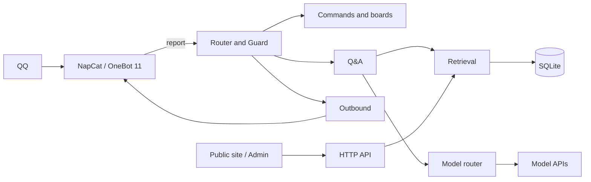

# Piaoxue Miao · QQ Knowledge Base Bot

<p align="center">
  <b>Retrieval over a private knowledge base, answered by an LLM, running in a single Spring Boot process</b>
</p>

<p align="center">
  
  
  
  
  
</p>

> Docs: [Architecture](docs/architecture.md) · [Retrieval](docs/retrieval.md) · [Knowledge Base](docs/knowledge-base.md) · [Deployment](docs/deployment.md) · [Development](docs/development.md) · [中文](README.md)

---

## 1. Overview

This project connects to QQ through OneBot 11 and answers questions for gaming communities. A question is first matched against a private corpus; the retrieved passages are then passed to an LLM for composition. When the corpus has no relevant material, the bot says so instead of answering from model memory.

The same process also hosts a command system, scheduled announcements, an interactive map, a public site and an admin console. All persistent state lives in one SQLite file. There is no Redis, no message queue and no second database; the deployment unit is a single jar.

| Entry | Audience | Form |
|---|---|---|
| QQ group | Members | Mention the bot, slash commands, scheduled posts |
| Public site | Members and visitors | Library search, entry pages, interactive map, about page |
| Admin console | Operator | Stats, knowledge base, commands, map, page copy, system settings |

## 2. Capabilities

### 2.1 QQ group

| Capability | Description |
|---|---|
| Knowledge base Q&A | Three recall paths, RRF fusion, cross-encoder rerank, top 5 passages as evidence |
| Tool calls | Read-only tools `lookup`, `search_titles`, `locate`, bounded by call and time budgets |
| Commands | Template, action and agent commands. Parameters and role tiers configured in the console |
| Scheduled posts | Daily, weekly, every N days or N occurrences, with a dedicated delivery queue and retries |
| Place questions | Relative bearing and distance to the nearest landmark, plus an annotated map image |
| Quotes and images | Read quoted text and images. Image questions go to a vision-capable model |
| Inline images | `[[img:source:name]]` markers are replaced with real images in the same message |
| Safety and cost | Five zero-token local checks, outbound filtering, daily budgets per user, group and instance |

### 2.2 Admin console

| Capability | Description |
|---|---|
| Statistics | Volume, hit rate, top cosine distribution, keywords, retrieval sources, admin visits |
| Knowledge base | Blocks and documents, terms, categories, wiki import, title vector backfill |
| Commands and boards | Parameter tables, reply templates, actions, access lists, delivery records |
| Map | Place CRUD, notes, layer toggles, offset review, tile warming |
| Pages | Home carousel, site info, per-page copy. Defaults live in code; the database stores overrides only |
| System | Model connectivity test, hot model switch, live logs over SSE, whitelisted hot config |

## 3. Architecture



Message flow:

| Stage | Behavior |
|---|---|
| Intake | Deduplicate, return 204 immediately, process in a worker pool |
| Dispatch | Messages starting with `/` go to the command pool, others to the chat pool |
| Access | Group mention requirement, private policy, group and user blacklists. Commands share the same check |
| Commands | Templates render immediately; actions execute; agent commands continue to Guard |
| Guard | access, mention, rate-limit, content-gate and inbound-words |
| Retrieval | Body vectors, glossary keywords and title vectors, fused and reranked |
| Answer | Passages injected as `<<<KNOWLEDGE>>>`; the model may call read-only tools |
| Outbound | Filter, split, merge-forward, pace. The only send path |
| Recording | Question, answer, retrieval metrics, latency and keywords |

Module boundaries are enforced by 14 ArchUnit rules in `ArchitectureTest`. A violation fails the build.

| Boundary | Rule |
|---|---|
| Protocol | Only `onebot/` knows protocol details; business packages must not depend on the protocol client |
| Sending | Only `OutboundSender` sends messages, so every path passes filtering and pacing |
| Models | Only `llm/` depends on the model SDK. The fallback chain lives in one place |
| Guard | `guard/` must not depend on the knowledge base, QA or LLM components |
| Storage | `java.sql` appears only under `persistence/` |
| Knowledge base | Core must not depend on ingest sources, admin or public API |

See [docs/architecture.md](docs/architecture.md) for the full design.

## 4. Stack

| Layer | Choice |
|---|---|
| Backend | Java 17, Spring Boot 3.5.16, Maven 3.9+ |
| Models | LangChain4j 1.20.0, OpenAI-compatible APIs, multi-provider fallback |
| Storage | SQLite, sqlite-jdbc 3.53.4.0, WAL, single serialized connection, 30 tables |
| Retrieval | bge-m3 embeddings, glossary keywords, title-vector gate, bge-reranker-v2-m3 |
| Map rendering | Java2D viewport tile composition, markers, JPEG encoding, on-disk tile cache |
| Spreadsheets | Apache POI 5.3.0 for term and category import/export |
| Frontend | Vue 3.5, vue-router 4, Vite 6, TypeScript 5.7, in-house component library |
| Protocol | NapCat, Docker, OneBot 11 |
| Hosting | Nginx, systemd |
| Quality | JUnit 5, AssertJ, Mockito, ArchUnit 1.3.0, Playwright |

## 5. Quick Start

### 5.1 Requirements

| Component | Requirement |
|---|---|
| JDK | 17 or newer |
| Maven | 3.9+ |
| Node | 20+, build time only |
| pnpm | Enabled through corepack |
| Docker | Required for NapCat |
| Network | Access to model APIs and wiki.gg |

### 5.2 Run

```bash
cp .env.example .env
# Set ONEBOT_TOKEN, OPENCODE_GO_API_KEY, SILICONFLOW_API_KEY, ADMIN_PASSWORD

cd deploy && docker compose up -d    # start NapCat and sign in
./scripts/build-web.sh               # build frontend into server/web-dist
cd server && mvn spring-boot:run     # start the application
```

The service listens on `0.0.0.0:8080`. The admin console is served at `/admin/` and the public site at `/`.

```bash
./scripts/health-check.sh
```

The scripts are bash. On Windows, run them in WSL or Git Bash, or execute the commands manually.

### 5.3 Frontend development

```bash
cd web
pnpm install
pnpm dev
```

Public site: `http://localhost:5173/public.html`. Admin console: `http://localhost:5173/admin.html`. The dev server proxies `/api` and `/admin/api` to port 8080.

## 6. Configuration

Sources, from lowest to highest priority: `application.yml`, environment variables and `.env`, `config/overrides.yml`, command-line arguments.

| Variable | Required | Purpose |
|---|---|---|
| `ONEBOT_TOKEN` | Yes | Must match the NapCat access token |
| `ONEBOT_API_BASE` | Yes | NapCat HTTP endpoint, default `http://127.0.0.1:3000` |
| `OPENCODE_GO_API_KEY` | Yes | Default chat provider |
| `DEEPSEEK_API_KEY` | No | Fallback chat provider |
| `SILICONFLOW_API_KEY` | Yes | Embedding and rerank models |
| `DASHSCOPE_API_KEY` | No | Backup embedding provider, disabled by default |
| `ADMIN_PASSWORD` | Yes | Empty value makes the whole admin console return 503 |

Database, corpus, image, tile and log paths are relative to the process working directory. Starting from `server/` places data under `server/data/`. Startup logs print resolved absolute paths.

The bot persona lives in `system.md` at the repository root; `system.md.example` is the template. Restart after editing; no rebuild is required.

## 7. Layout

```text
server/       Spring Boot application and HTTP API
web/          Frontend: public site, admin console, shared components and theme
deploy/       NapCat container and Nginx configuration
scripts/      Build, health check, preflight, retrieval gate, document validator
corpus/       Sample corpus and source data
docs/         Architecture, retrieval, knowledge base, deployment and development
tests/        Golden set, portable UI tests, manual probes, cleanup SQL
```

## 8. Quality

| Mechanism | Scope |
|---|---|
| Architecture tests | 14 dependency rules covering protocol, sending, models, SQL and KB layering |
| Unit and integration tests | Business logic, persistence, hot configuration |
| Retrieval gate | Golden set by five categories. Missing corpus or API key counts as failure |
| UI audit | Horizontal overflow, hit-target size, console errors, theme consistency |
| Preflight | Secrets, tests, packaging, frontend build, database and retrieval gate |

```bash
./scripts/preflight.sh      # full release check
./scripts/golden-gate.sh    # retrieval gate only
```

See [docs/development.md](docs/development.md) for test details.

## 9. Documentation

| Document | Content |
|---|---|
| [docs/architecture.md](docs/architecture.md) | Process topology, message pipeline, module boundaries, data model, configuration |
| [docs/retrieval.md](docs/retrieval.md) | Three recall paths, RRF, rerank, tool calls, public search |
| [docs/knowledge-base.md](docs/knowledge-base.md) | Block model, document format, import semantics, ingestion and operations |
| [docs/deployment.md](docs/deployment.md) | NapCat, systemd, Nginx, backup, upgrade and troubleshooting |
| [docs/development.md](docs/development.md) | Local setup, build, test layers, pre-commit checks |

## 10. Deployment

Production uses Nginx as reverse proxy, systemd for process supervision and a NapCat container for the QQ protocol. The admin console is served on a separate domain behind an IP allowlist; the public domain returns 404 for `/admin/`.

See [docs/deployment.md](docs/deployment.md) for the full procedure, systemd unit, Nginx configuration and security checklist.

## 11. Known Limits

| Item | Description |
|---|---|
| Single instance | SQLite and in-memory caches assume one process. No horizontal scaling |
| QQ protocol | Depends on NapCat and a dedicated account. Risk control and session loss remain possible |
| Corpus | The sample corpus targets Enshrouded. Replacing it requires the document format and vector rebuild |
| Models | Requires external OpenAI-compatible APIs plus a separate embedding and rerank service |
| Admin | Single administrator. No multi-user or role model |

## 12. License

No license file is included. Contact the author before use, redistribution or derivative work.

The sample corpus under `corpus/` is derived from `enshrouded.wiki.gg`. Copyright and licensing remain with the source site; verify the terms before redistributing.
