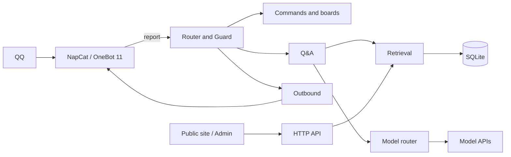

# Q-A-bot · QQ Knowledge Base Bot

<p align="center">
  <b>Private retrieval, LLM answers and an operations console in a single Spring Boot process</b>
</p>

<p align="center">
  
  
  
  
  
</p>

> Docs: [Architecture](docs/architecture.md) · [Retrieval](docs/retrieval.md) · [Knowledge Base](docs/knowledge-base.md) · [Deployment](docs/deployment.md) · [Development](docs/development.md) · [中文](README.md)

## Overview

Q-A-bot is a self-hosted QQ bot for gaming communities, connected through OneBot 11. Each question is first matched against a private knowledge base; the retrieved passages are then passed to an LLM for composition. When no supporting material is found, the bot says so instead of answering from model memory.

The same process provides commands and scheduled posts, an interactive map, voice replies, chat distillation, a public site and an admin console. Structured state lives in one SQLite file, while images, map tiles and voice assets use local directories. There is no Redis, message queue or second database.

| Entry | Audience | Purpose |
|---|---|---|
| QQ group | Members | Mentions, slash commands, scheduled posts, voice replies |
| Public site | Members and visitors | Library search, entry pages, interactive map |
| Admin console | Operators | Knowledge base, commands, map, distillation, statistics and settings |

## Capabilities

| Capability | Implementation |
|---|---|
| Knowledge base Q&A | Body-vector, glossary-keyword and title-vector recall; RRF fusion followed by cross-encoder rerank, top 5 passages as evidence. See [retrieval](docs/retrieval.md) |
| Tool calls | Read-only `lookup`, `search_titles` and `locate`, limited to 3 calls, 3 round trips and 30 seconds per request |
| Commands and boards | Template, action and agent commands; boards support daily, weekly, every N days and N-occurrence delivery with retries |
| Place questions and map | Relative bearing and distance to the nearest landmark, plus an annotated map image |
| Voice replies | edge-tts synthesis, an audio asset library, keyword triggers and the `play_voice` model tool |
| Chat distillation | Capture selected groups, distill batches into knowledge notes, review them and import into the knowledge base |
| Safety and cost | Five zero-token local checks, per-user/group/global daily budgets, outbound filtering and pacing |
| Public site and console | Public read-only search and map; console for knowledge base, commands, map, page copy and system settings |

## Architecture



| Stage | Processing |
|---|---|
| Intake and dispatch | Deduplicate and return 204 immediately; messages starting with `/` go to the command pool, others to the chat pool |
| Access and commands | Group mention requirement, private policy and blacklists; template commands render immediately, agent commands continue to Guard |
| Safety and budget | access → mention → rate-limit → content-gate → inbound-words, then daily budget checks |
| Retrieval and answer | Three recall paths and rerank; passages injected as `<<<KNOWLEDGE>>>`, with read-only tools available to the model |
| Outbound and recording | `OutboundSender` filters, splits, sends long replies as merged forwards and paces every message; QA metrics are recorded in parallel |

Module boundaries are enforced by 14 ArchUnit rules covering protocol, sending, models, SQL, knowledge-base layering and configuration dependencies. Data model, directory layout and configuration precedence are documented in [architecture](docs/architecture.md).

## Stack

| Layer | Choice |
|---|---|
| Backend | Java 17, Spring Boot 3.5.16, LangChain4j 1.20.0 |
| Storage | SQLite, sqlite-jdbc 3.53.4.0, WAL, single serialized connection, about 40 tables |
| Retrieval | bge-m3 embeddings, glossary keywords, title-vector gate, bge-reranker-v2-m3 |
| Frontend | Vue 3.5, Vue Router 4, Vite 6, TypeScript 5.7, in-house components |
| Protocol and hosting | NapCat, OneBot 11, Docker, Nginx, systemd |
| Other | Java2D map rendering, Apache POI 5.3, JUnit 5, ArchUnit 1.3, Playwright |

## Quick Start

Requires JDK 17+, Maven 3.9+, Node 20+, pnpm and Docker. The host must reach the model APIs and wiki.gg; voice replies additionally require ffmpeg and edge-tts.

```bash
cp .env.example .env
# Set ONEBOT_TOKEN, OPENCODE_GO_API_KEY, SILICONFLOW_API_KEY and ADMIN_PASSWORD

(cd deploy && docker compose up -d)   # start NapCat and sign in
./scripts/build-web.sh                # build frontend into server/web-dist
(cd server && mvn spring-boot:run)    # start the application
```

The service listens on `0.0.0.0:8080`. The public site is served at `/` and the admin console at `/admin/`. Run the health check after startup:

```bash
./scripts/health-check.sh
```

The scripts are bash; on Windows use WSL or Git Bash. See [deployment](docs/deployment.md) for environment setup, systemd and Nginx; see [development](docs/development.md) for local development, test layers and the retrieval gate.

## Configuration

| Variable | Required | Purpose |
|---|---|---|
| `ONEBOT_TOKEN` | Yes | Must match the NapCat access token |
| `OPENCODE_GO_API_KEY` | Yes | Default chat provider |
| `SILICONFLOW_API_KEY` | Yes | Embedding and rerank models |
| `ADMIN_PASSWORD` | Yes | Empty value makes the admin console return 503 |
| `DEEPSEEK_API_KEY` | No | Fallback chat provider |

Configuration precedence, lowest to highest: `application.yml`, environment variables and `.env`, `config/overrides.yml`, command-line arguments. Database, corpus, image, tile and log paths are relative to the process working directory; starting from `server/` places them under `server/data/`. The system prompt is `system.md` at the repository root; `system.md.example` is the template.

See [.env.example](.env.example) and [deployment](docs/deployment.md) for the full set.

## Layout

```text
server/       Spring Boot application and HTTP API
web/          Public site, admin console, shared components and theme
deploy/       NapCat container and Nginx configuration
scripts/      Build, health check, preflight, retrieval gate, document validator
docs/         Architecture, retrieval, knowledge base, deployment and development
tests/        Golden set, portable UI tests, manual probes, cleanup SQL
```

## Quality

Quality is covered at three levels: backend unit and integration tests, 14 ArchUnit architecture rules and a retrieval golden-set gate. The frontend adds a Playwright audit for horizontal overflow, hit-target size, console errors and theme consistency. Run before release:

```bash
./scripts/preflight.sh      # secrets, tests, packaging, frontend build, database and retrieval gate
./scripts/golden-gate.sh    # retrieval regression only
```

See [development](docs/development.md) for details.

## Documentation

- [Architecture](docs/architecture.md): process topology, message pipeline, module boundaries, data model, configuration
- [Retrieval](docs/retrieval.md): three recall paths, RRF, rerank, tool calls, public search
- [Knowledge Base](docs/knowledge-base.md): block model, document format, import semantics, ingestion and operations
- [Deployment](docs/deployment.md): NapCat, systemd, Nginx, backup, upgrade and troubleshooting
- [Development](docs/development.md): local setup, build, test layers, pre-commit checks
- [Documentation index](docs/README.md): reading order

## Known Limits

| Item | Description |
|---|---|
| Single instance | Designed for one 2-core/2 GB host and small communities. SQLite and in-memory caches do not support horizontal scaling |
| QQ protocol | Depends on NapCat and a dedicated account. Risk control and session loss remain possible |
| Corpus and map | Public copy is game-neutral by default; map and wiki import default to the Enshrouded wiki. Other games require their own source and map data |
| Models | Requires external OpenAI-compatible APIs plus a separate embedding and rerank service |
| Admin | Single administrator. No multi-user or role model |

## License

No license file is included. Contact the author before use, redistribution or derivative work.
