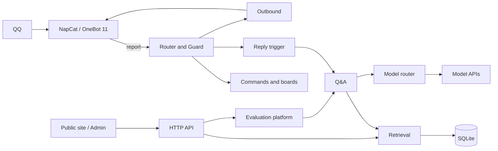

# Q-A-bot · QQ Knowledge Base Bot

<p align="center">
  <b>Private retrieval, LLM answers, evaluation platform and operations console in a single Spring Boot process</b>
</p>

<p align="center">
  
  
  
  
  
</p>

> Docs: [Architecture](docs/architecture.md) · [Retrieval](docs/retrieval.md) · [Knowledge Base](docs/knowledge-base.md) · [Evaluation](docs/eval.md) · [Deployment](docs/deployment.md) · [Development](docs/development.md) · [中文](README.md)

## Overview

Q-A-bot is a self-hosted QQ bot for gaming communities, connected through OneBot 11. Each question is first matched against a private knowledge base; the retrieved passages are then passed to an LLM for composition. When no supporting material is found, the bot says so instead of answering from model memory.

The same process provides commands and scheduled posts, probability-based replies, an interactive map, voice replies, chat distillation, an evaluation platform, a public site and an admin console. Structured state lives in SQLite, while images, map tiles and voice assets use local directories. There is no Redis, message queue or second database.

| Entry | Audience | Purpose |
|---|---|---|
| QQ group | Members | Mentions, slash commands, scheduled posts, probability-based replies, voice replies |
| Public site | Members and visitors | Library search, entry pages, interactive map |
| Admin console | Operators | Knowledge base, commands, map, distillation, evaluation, statistics and settings |

## Capabilities

| Capability | Implementation |
|---|---|
| Knowledge base Q&A | Body-vector, glossary-keyword and title-vector recall; RRF fusion followed by cross-encoder rerank, top 5 passages as evidence. See [retrieval](docs/retrieval.md) |
| Intent routing | Rule-based detection of social, meta and out-of-scope requests; retrieval is skipped for those, while corrections include the previous turn. See [intent routing](docs/intent.md) |
| Probability-based replies | Replies to ambient messages at a configurable probability; mentions, name-only calls and quotes of the bot bypass the probability. Replies to calls only by default |
| Tool calls | `lookup`, `search_titles`, `locate`, `play_voice` and `say`, limited to 3 calls, 3 round trips and 30 seconds per request |
| Commands and boards | Template, action and agent commands; boards support daily, weekly, every N days and N-occurrence delivery with retries |
| Place and resource questions | Relative bearing and distance to the nearest landmark; resource hotspots rendered as an annotated distribution map |
| Voice replies | edge-tts synthesis, an audio asset library, keyword triggers, and the `play_voice` and `say` model tools. See [voice](docs/voice.md) |
| Chat distillation | Capture selected groups, distill batches into knowledge notes, review them and import into the knowledge base |
| Evaluation platform | Datasets, batches, execution spans, rule and model judging, trend comparison, cost and alerts, human review; the executor calls the production retrieval and answer path. See [evaluation](docs/eval.md) |
| Token usage | Every model round trip records input and output tokens; provider usage is used when present, otherwise estimated and marked. See [token usage](docs/llm-usage.md) |
| Safety and cost | Five zero-token local checks, per-user/group/global daily budgets, outbound filtering and pacing |
| Public site and console | Public read-only search and map; console with VIEWER, EDITOR and ADMIN roles and configurable role areas |

## Architecture



| Stage | Processing |
|---|---|
| Intake and dispatch | Deduplicate and return 204 immediately; messages starting with `/` go to the command pool, others to the chat pool |
| Trigger and access | Mentions, name-only calls and quotes bypass probability; ambient replies follow group allowlists and thresholds, then the five Guard stages |
| Retrieval and answer | Three recall paths and rerank; passages injected as `<<<KNOWLEDGE>>>`, with tools available to the model |
| Evaluation | The evaluation platform replays the production retrieval and answer path per case, recording spans, retrieval snapshots, tool calls and judgements |
| Outbound and recording | `OutboundSender` filters, splits, sends long replies as merged forwards and paces every message; QA metrics and token ledgers are written alongside |

Module boundaries are enforced by 18 ArchUnit rules covering protocol, sending, models, SQL, knowledge-base, intent, probability replies and voice boundaries. Data model, directory layout and configuration precedence are documented in [architecture](docs/architecture.md).

## Stack

| Layer | Choice |
|---|---|
| Backend | Java 17, Spring Boot 3.5.16, LangChain4j 1.22.0 |
| Storage | SQLite, sqlite-jdbc 3.53.4.0, WAL, single serialized connection; main database and a separate evaluation database |
| Retrieval | bge-m3 embeddings, glossary keywords, title-vector gate, bge-reranker-v2-m3 |
| Frontend | Vue 3.5, Vue Router 4, Vite 6, TypeScript 5, in-house components |
| Protocol and hosting | NapCat, OneBot 11, Docker, Nginx, systemd |
| Other | Java2D map rendering, Apache POI 5.3, JUnit 5, ArchUnit 1.3, Playwright |

## Quick Start

Requires JDK 17+, Maven 3.9+, Node 20+, pnpm and Docker. The host must reach the model APIs and wiki.gg; voice replies additionally require ffmpeg and edge-tts.

```bash
cp .env.example .env
# Set ONEBOT_TOKEN, OPENCODE_GO_API_KEY, SILICONFLOW_API_KEY, ADMIN_PASSWORD and ADMIN_QQ

cp system.md.example system.md

(cd deploy && docker compose up -d)   # start NapCat and sign in
./scripts/build-web.sh                # build frontend into server/web-dist
(cd server && mvn spring-boot:run)    # start the application
```

The service listens on `0.0.0.0:8080`. The public site is served at `/` and the admin console at `/admin/`. Run the health check after startup:

```bash
./scripts/health-check.sh
```

The scripts are bash; on Windows use WSL or Git Bash. See [deployment](docs/deployment.md) for environment setup, systemd and Nginx; see [development](docs/development.md) for local development, test layers and the retrieval gate.

## Configuration

| Variable | Required | Purpose |
|---|---|---|
| `ONEBOT_TOKEN` | Yes | Must match the NapCat access token; inbound events are verified with it |
| `OPENCODE_GO_API_KEY` | Yes | Default chat provider |
| `SILICONFLOW_API_KEY` | Yes | Embedding and rerank models |
| `ADMIN_PASSWORD` | Yes | Initial password of the first administrator; empty disables the admin console with 503 |
| `ADMIN_QQ` | First login | QQ bound to the first administrator; later accounts use the account table |
| `DEEPSEEK_API_KEY` | No | Fallback chat provider |

Configuration precedence, lowest to highest: `application.yml`, environment variables and `.env`, `config/overrides.yml`, command-line arguments. Database, corpus, image, tile and log paths are relative to the process working directory; starting from `server/` places them under `server/data/`. The system prompt is `system.md` at the repository root; `system.md.example` is the template.

The public brand, browser title and admin console brand all read `app.bot.name`; change it under Bot settings → Bot identity to update the whole site.

See [.env.example](.env.example) and [deployment](docs/deployment.md) for the full set.

## Layout

```text
server/       Spring Boot application, evaluation platform and HTTP API
web/          Public site, admin console, shared components and theme
deploy/       NapCat container and Nginx configuration
scripts/      Build, health check, preflight, retrieval and evaluation gates, document validator
docs/         Architecture, retrieval, knowledge base, evaluation, deployment and development
tests/        Golden set, portable UI tests, manual probes, cleanup SQL
```

## Quality

Quality is covered at four levels: backend unit and integration tests, 18 ArchUnit architecture rules, a retrieval golden-set gate and an evaluation-platform gate. The frontend adds a Playwright audit for horizontal overflow, hit-target size, console errors and theme consistency. Run before release:

```bash
./scripts/preflight.sh      # secrets, tests, packaging, frontend build, database and retrieval gate
./scripts/golden-gate.sh    # retrieval regression only
./scripts/eval-gate.sh      # latest completed evaluation batch
```

The evaluation gate needs an available evaluation database and a completed batch; it reports an undetermined result rather than passing silently. See [development](docs/development.md) for details.

## Documentation

- [Architecture](docs/architecture.md): process topology, message pipeline, module boundaries, data model, configuration
- [Retrieval](docs/retrieval.md): three recall paths, RRF, rerank, tool calls, public search
- [Intent routing](docs/intent.md): rule signals, retrieval skipping, conversation correction, probability replies and answer contracts
- [Knowledge Base](docs/knowledge-base.md): block model, document format, import semantics, ingestion and operations
- [Evaluation](docs/eval.md): datasets, batches, judging, trends, alerts, review and cost
- [Voice](docs/voice.md): voice reply pipeline, asset library, TTS and triggers
- [Security](docs/security.md): trust boundaries, identity, data protection and launch checks
- [Token usage](docs/llm-usage.md): accounting, estimation, storage and API
- [Deployment](docs/deployment.md): NapCat, systemd, Nginx, backup, upgrade and troubleshooting
- [Development](docs/development.md): local setup, build, test layers, pre-commit checks
- [Documentation index](docs/README.md): reading order

## Known Limits

| Item | Description |
|---|---|
| Single instance | Designed for one 2-core/2 GB host and small communities. SQLite and in-memory caches do not support horizontal scaling |
| QQ protocol | Depends on NapCat and a dedicated account. Risk control and session loss remain possible |
| Corpus and map | Public copy is game-neutral by default; map and wiki import default to the Enshrouded wiki. Other games require their own source and map data |
| Models | Requires external OpenAI-compatible APIs plus a separate embedding and rerank service |
| Admin | Multiple VIEWER, EDITOR and ADMIN accounts with configurable areas; no TOTP or WebAuthn, so public deployments should add Cloudflare Access or a VPN |
| Evaluation | Model judging and human review depend on an available model and labelled samples; without a batch the gate cannot determine a result |

## Credits

Map marker data comes from [The Worst Map Mod](https://github.com/Greeneye0/worst-map-mod-enshrouded) by Greeneye0, released under the MIT license; copyright remains with the original author. `scripts/map-mod-extract.py` extracts the marker tables from its source into `server/src/main/resources/map-mod/points.json`; the full license text is in [map-mod/LICENSE](server/src/main/resources/map-mod/LICENSE).

Copyright notices on the public site live on the About page; the footer carries the byline and filing information only.

## License

No license file is included. Contact the author before use, redistribution or derivative work.
