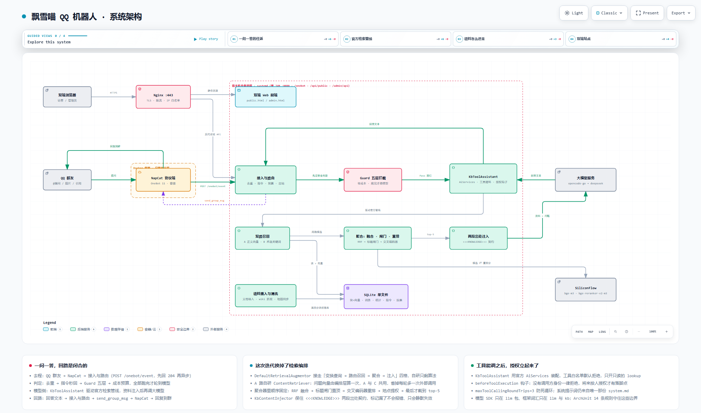

# 飘雪喵 · 问答机器人

<p align="center">
  <b>把群里的一句提问，变成先查自己知识库、再由大模型组织的回答</b><br>
  检索 + 提示词编排 + 安全与成本控制，不训练模型
</p>

<p align="center">
  
  
  
  
  
</p>

> 📖 **文档**：[系统说明书](docs/md/系统说明书.md) ｜ [公网部署指南](docs/md/公网部署指南.md) ｜ [架构图](docs/diagrams/system-architecture.html) ｜ [English](README.en.md)

---

## 一、项目说明

群友 @ 机器人提问，系统先在自己的知识库里检索，再把检索到的内容交给大模型组织成人话。

| 入口 | 给谁用 | 形态 |
|---|---|---|
| QQ 群 | 群友 | @ 机器人提问，或 `/命令` |
| 公开站 | 群友与访客 | `public.html`，浏览资料库与问答广场 |
| 管理后台 | 站长 | `admin.html`，看板、知识库、设置 |

| 维度 | 当前 | 换成别的要动哪里 |
|---|---|---|
| 消息平台 | QQ，经 NapCat / OneBot 11 | `onebot/` 与 `incoming/` |
| 知识库语料 | 《雾锁王国》 | 按[文档格式规范](docs/md/知识库文档格式规范.md)导入新语料 |
| 机器人人设 | `system.md`，模板 `system.md.example` | 只改这份文件，不用重新打包 |
| 对话模型 | opencode-go，降级 DeepSeek | 后台「设置」页，或 `llm/` |

四条铁律由 `ArchitectureTest` 强制，越界依赖会让构建失败：

| 铁律 | 含义 |
|---|---|
| `onebot/` | 唯一知道 OneBot 协议的地方 |
| `OneBotApiClient` | 唯一发消息出口 |
| `llm/` | 唯一知道用哪个模型的地方 |
| `guard/` | 唯一有权拒绝的地方 |

## ⚙️ 工作原理



一条消息的路径：事件接入 → 五层 Guard → 三路召回 → RRF 融合与交叉编码重排 → 大模型作答 → 分片回群。

| 环节 | 做什么 |
|---|---|
| 接入与路由 | 去重后立即返回 204；REST 与配置热更新走同一层 |
| 安全与成本 | 准入、提及、限流、内容闸门、入站词五层本地判定，出口再做敏感词过滤 |
| 检索 | 正文向量与术语关键词两路召回，标题向量闸门命中即置顶，RRF 融合后交交叉编码器重排取 top-5 |
| 作答 | 检索结果以 `<<<KNOWLEDGE>>>` 交给模型，可回调只读的 `lookup` 工具，资料不足时直说没查到 |
| 出站 | 分片发送，异步落库统计与原文 |

## 二、功能

| 能力 | 说明 |
|---|---|
| 知识库问答 | 三路召回加重排，取 top-5 交给模型；资料不足不编造 |
| 工具调用 | 模型可回调只读的 `lookup`；白名单默认拒绝，无调用方身份一律拒绝，轮次上限 3 |
| 指令系统 | `/help`、`/ping` 一类话术秒回，不走限流也不调模型 |
| 安全中间层 | 五层本地拦截，零 token 成本；出口再做敏感词过滤 |
| 成本预算 | 每人、每群、全局每日额度与 token 上限，超限降级 |
| 图片与引用 | 读被引用的文字与图片，带图提问走视觉模型 |
| 回复带图 | 回复里的 `[[img:来源:名字]]` 标记换成真图，与正文同一条消息发出；图片来源按 `ImageSource` 扩展：`kb:` 知识库配图、`map:` 地点问答的地图截图 |
| 问答广场 | 群内发起求助，投票认可的回答沉淀为改进提案 |

## 三、上游依赖

| 服务 | 用途 | 配置项 |
|---|---|---|
| [OpenCode Go](https://opencode.ai) | 对话模型，默认，支持视觉 | `OPENCODE_GO_API_KEY`、`OPENCODE_GO_MODEL` |
| [DeepSeek](https://api.deepseek.com) | 对话模型，降级链 | `DEEPSEEK_API_KEY` |
| [硅基流动](https://siliconflow.cn) | 向量 `BAAI/bge-m3`，重排 `BAAI/bge-reranker-v2-m3` | `SILICONFLOW_API_KEY` |
| [阿里云百炼](https://dashscope.aliyun.com) | 备用向量，默认关闭 | `DASHSCOPE_API_KEY` |
| [NapCat](https://github.com/NapNeko/NapCatQQ) | QQ 协议端，OneBot 11 | `ONEBOT_API_BASE`、`ONEBOT_TOKEN` |
| 《雾锁王国》wiki | 语料抓取来源 | 后台 wiki 抓取配置 |

## 四、技术栈

| 层 | 选型 |
|---|---|
| 后端 | Java 17，Spring Boot 3.5.16，Maven 3.9+ |
| 模型接入 | LangChain4j 1.20.0，OpenAI 兼容协议，多厂商即多实例加降级链 |
| 存储 | SQLite 单文件，sqlite-jdbc 3.53.4.0，知识库与统计同库 |
| 表格导入导出 | Apache POI 5.3.0 |
| 前端 | Vue 3.5，vue-router 4，Vite 6，TypeScript 5.7，自研组件库 `web/src/shared/ui` |
| 协议端 | NapCat，Docker，OneBot 11 |
| 反向代理与托管 | Nginx，systemd |
| 工程质量 | JUnit 5，AssertJ，Mockito，ArchUnit 1.3.0，Playwright |

## 🗂 项目结构

```text
server/   Spring Boot 单体，唯一进生产的 Java
web/      前端双端：public/ admin/ shared/ theme/
deploy/   NapCat 容器与 Nginx 配置
scripts/  构建、自检、回归门禁、wiki 导入
docs/     md/ 文档源，html/ 渲染版，diagrams/ 架构图
tests/    黄金集、探针、Playwright
plans/    规划文档
```

## 🛠 开发环境

| 项目 | 版本 / 说明 |
|---|---|
| JDK | 17 起，本仓库在 21 上运行 |
| 构建 | Maven 3.9+ |
| 前端 | Node 20+ 与 pnpm |
| 数据库 | SQLite，文件在 `server/data/qa/qqbot.sqlite`，路径按进程工作目录解析，务必从 `server/` 启动 |
| 协议端 | Docker，NapCat 容器 |
| 测试 | 后端 486 个用例，前端 `vue-tsc` 加 `vite build` |

### 本地跑起来

```bash
cp .env.example .env                 # 填 ONEBOT_TOKEN、模型 key、SILICONFLOW_API_KEY、ADMIN_PASSWORD
cd deploy && docker compose up -d    # 起协议端并登录 QQ
./scripts/build-web.sh               # 构建前端并同步到 server/web-dist/
cd server && mvn spring-boot:run     # 起业务层 :8080
./scripts/health-check.sh            # 自检
```

前端开发模式：`cd web && pnpm install && pnpm dev`，公开站为 5173/public.html，后台为 5173/admin.html。

## 五、部署

NapCat 容器、systemd 托管 jar、Nginx 反代，步骤见[公网部署指南](docs/md/公网部署指南.md)。

| 操作 | 命令 |
|---|---|
| 构建前端 | `./scripts/build-web.sh` |
| 构建后端 | `./scripts/build-server.sh package -DskipTests` |
| 更新 | 换 jar 后 `systemctl restart` |
| 上线前自检 | `./scripts/preflight.sh` |
| 检索回归 | `./scripts/golden-gate.sh` |

宿主与容器是两套环境，容器侧构建一律走 `.toolchain/`。

## 六、文档索引

| 想干什么 | 看哪份 |
|---|---|
| 了解全貌 | [系统说明书](docs/md/系统说明书.md) |
| 部署上线 | [公网部署指南](docs/md/公网部署指南.md) |
| 接 QQ | [协议层搭建指南](docs/md/协议层搭建指南.md) · [NapCat 新手接入](docs/md/napcat-新手接入指南.md) · [登录丢失排查](docs/md/NapCat登录丢失排查与解决.md) |
| 维护知识库 | [知识库运营手册](docs/md/知识库运营手册.md) · [导入与使用手册](docs/md/知识库导入与使用手册.md) · [文档格式规范](docs/md/知识库文档格式规范.md) |
| 运维命令 | [运维命令速查](docs/md/知识库运维命令速查.md) |
| 检索设计 | [检索基线](docs/md/检索基线.md) · [回答策略与知识库设施设计](docs/md/回答策略与知识库设施设计.md) |
| 改摄入 | [知识库摄入边界与激活协议](docs/md/知识库摄入边界与激活协议.md) |
| 前后端细节 | [server/README.md](server/README.md) · [web/README.md](web/README.md) |

## 许可

未附许可证文件。使用、转载或二次分发前请联系作者。
