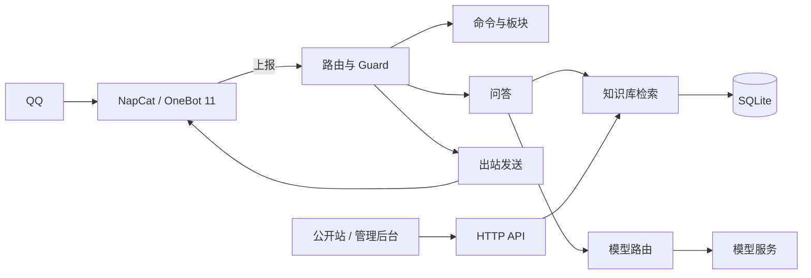

# 飘雪喵 · QQ 群知识库问答机器人

<p align="center">
  <b>自有知识库检索与大模型作答，运行在单个 Spring Boot 进程中</b>
</p>

<p align="center">
  
  
  
  
  
</p>

> 文档：[架构](docs/architecture.md) · [检索](docs/retrieval.md) · [知识库](docs/knowledge-base.md) · [部署](docs/deployment.md) · [开发](docs/development.md) · [English](README.en.md)

---

## 1. 项目说明

本项目通过 OneBot 11 接入 QQ，面向游戏玩家群提供知识库问答。收到提问后，系统先在自有语料中检索，再把命中资料交给大模型组织回答；资料不足时明确说明未查到，不使用模型自身知识补全。

同一进程还承载命令系统、定时板块、交互地图、公开站与管理后台。业务状态保存在一个 SQLite 文件中，图片与地图瓦片走本地目录；没有 Redis、消息队列或第二个数据库。

| 入口 | 使用者 | 形态 |
|---|---|---|
| QQ 群 | 群友 | @ 机器人提问、斜杠命令、定时板块投递 |
| 公开站 | 群友与访客 | 资料库检索、条目浏览、交互地图、关于页 |
| 管理后台 | 站长 | 统计、知识库、命令与板块、地图、页面文案、系统设置 |

## 2. 核心能力

### 2.1 群聊

| 能力 | 说明 |
|---|---|
| 知识库问答 | 三路召回、RRF 融合、交叉编码器重排，取前 5 条作为依据 |
| 工具调用 | 模型可调用只读工具 `lookup`、`search_titles`、`locate`，受次数与时间预算约束 |
| 命令系统 | 话术、动作、智能问答三类命令，参数模板与权限档位可在后台配置 |
| 定时板块 | 每天、每周、每 N 天或共 N 次的公告与提醒，独立投递队列与重试 |
| 地点问答 | 返回相对最近地标的方位与距离，并附一张带标记的地图截图 |
| 引用与图片 | 读取被引用消息的文字与图片，带图提问交给视觉模型 |
| 回复带图 | 回复中的 `[[img:来源:名字]]` 替换为真实图片，与正文同条发送 |
| 安全与成本 | 五层本地判定零 token 拦截，出站过滤，按用户、群、全局设置每日预算 |

### 2.2 管理后台

| 能力 | 说明 |
|---|---|
| 统计 | 问答量、命中率、最高余弦分布、关键词、检索来源、后台访问 |
| 知识库 | 块与文档、词条、分类、wiki 抓取、标题向量补建 |
| 命令与板块 | 参数表、回复模板、执行动作、权限名单、投递记录 |
| 地图 | 点位增删改、备注、图层开关、整体偏移复核、瓦片预热 |
| 页面 | 首页轮播、站点信息、各页文案。正文默认值在代码中，表里只存覆盖值 |
| 系统 | 模型连通性测试、模型热切换、实时日志 SSE、配置白名单热更新 |

## 3. 架构



一条消息的处理顺序：

| 阶段 | 行为 |
|---|---|
| 接入 | 去重后立即返回 204，处理放入线程池 |
| 分诊 | 以 `/` 开头进命令池，其余进问答池 |
| 准入 | 群聊必须 @、私聊策略、群与用户黑名单。指令同样受准入约束 |
| 命令 | 话术就地渲染；动作执行读写库；智能问答继续走 Guard |
| 安全 | access、mention、rate-limit、content-gate、inbound-words 五层 |
| 检索 | 正文向量、术语关键词、标题向量三路，融合后重排 |
| 作答 | 资料以 `<<<KNOWLEDGE>>>` 注入，模型可调用只读工具 |
| 出站 | 过滤、分片、合并转发、发送节奏控制，唯一出口 |
| 记录 | 问题、回答、检索指标、耗时、关键词写入统计表 |

模块边界由 `ArchitectureTest` 的 14 条 ArchUnit 规则强制，违反即构建失败：

| 边界 | 约束 |
|---|---|
| 协议 | 只有 `onebot/` 接触协议细节，业务包不得依赖协议客户端 |
| 发送 | 只有 `OutboundSender` 能发消息，所有路径必须经过过滤与节流 |
| 模型 | 只有 `llm/` 依赖模型 SDK；模型降级链集中在一处 |
| 安全 | `guard/` 不依赖知识库、统计与模型，保证零成本可执行 |
| 存储 | `java.sql` 只允许出现在 `persistence/` |
| 知识库 | 核心不反向依赖摄入来源、管理后台与公开站 |

详见 [docs/architecture.md](docs/architecture.md)。

## 4. 技术栈

| 层 | 选型 |
|---|---|
| 后端 | Java 17、Spring Boot 3.5.16、Maven 3.9+ |
| 模型接入 | LangChain4j 1.20.0、OpenAI 兼容协议、多 provider 降级链 |
| 存储 | SQLite、sqlite-jdbc 3.53.4.0、WAL、单连接串行写入、约 30 张表 |
| 检索 | bge-m3 向量、术语表关键词、标题向量闸门、bge-reranker-v2-m3 重排 |
| 地图出图 | Java2D 按视口裁瓦片、绘制点位、JPEG 编码、磁盘瓦片缓存 |
| 表格 | Apache POI 5.3.0，用于词条与分类导入导出 |
| 前端 | Vue 3.5、vue-router 4、Vite 6、TypeScript 5.7、自研组件库 |
| 协议端 | NapCat、Docker、OneBot 11 |
| 托管 | Nginx、systemd |
| 质量 | JUnit 5、AssertJ、Mockito、ArchUnit 1.3.0、Playwright |

## 5. 快速开始

### 5.1 前置条件

| 组件 | 要求 |
|---|---|
| JDK | 17 或更高 |
| Maven | 3.9+ |
| Node | 20+，仅构建前端时需要 |
| pnpm | 通过 corepack 启用 |
| Docker | 运行 NapCat |
| 网络 | 可访问模型 API 与 wiki.gg |

### 5.2 启动

```bash
cp .env.example .env
# 填写 ONEBOT_TOKEN、OPENCODE_GO_API_KEY、SILICONFLOW_API_KEY、ADMIN_PASSWORD

(cd deploy && docker compose up -d)   # 启动 NapCat 并扫码登录
./scripts/build-web.sh                # 构建前端并同步到 server/web-dist
(cd server && mvn spring-boot:run)    # 启动业务层
```

服务监听 `0.0.0.0:8080`。管理后台为 `/admin/`，公开站为 `/`。首次启动后可用健康自检：

```bash
./scripts/health-check.sh
```

脚本为 bash。Windows 上请在 WSL 或 Git Bash 中执行，也可以按脚本内的命令手工运行。

### 5.3 前端开发

```bash
cd web
pnpm install
pnpm dev
```

公开站为 `http://localhost:5173/public.html`，管理后台为 `http://localhost:5173/admin.html`。开发服务器把 `/api` 与 `/admin/api` 代理到 8080。

## 6. 配置

配置来源按优先级从低到高：`application.yml`、环境变量与 `.env`、`config/overrides.yml`、命令行参数。

| 变量 | 必填 | 用途 |
|---|---|---|
| `ONEBOT_TOKEN` | 是 | 与 NapCat 的 Access Token 一致 |
| `ONEBOT_API_BASE` | 否 | NapCat HTTP 地址，默认 `http://127.0.0.1:3000` |
| `OPENCODE_GO_API_KEY` | 是 | 默认对话模型 |
| `DEEPSEEK_API_KEY` | 否 | 降级对话模型 |
| `SILICONFLOW_API_KEY` | 是 | 向量与重排模型 |
| `DASHSCOPE_API_KEY` | 否 | 备用向量模型，默认关闭 |
| `ADMIN_PASSWORD` | 是 | 为空时管理后台整体返回 503 |

数据库、知识库、图片、瓦片与日志路径均相对进程工作目录。从 `server/` 启动时数据落在 `server/data/`。启动日志会打印解析后的绝对路径，部署后应核对。

机器人人格放在仓库根目录的 `system.md`，模板为 `system.md.example`。修改后重启生效，不需要重新打包。

## 7. 目录结构

```text
server/       Spring Boot 单体，业务层与 HTTP 接口
web/          前端双端：public 公开站、admin 管理后台、shared 组件与主题
deploy/       NapCat 容器与 Nginx 配置
scripts/      构建、自检、发版检查、检索门禁、文档校验
corpus/       示例语料与来源数据
docs/         架构、检索、知识库、部署、开发文档
tests/        黄金集、可移植 UI 测试、手工探针、清理 SQL
```

## 8. 质量保障

| 机制 | 内容 |
|---|---|
| 架构测试 | 14 条依赖规则，覆盖协议、发送、模型、SQL、知识库分层 |
| 单元与集成测试 | 后端业务逻辑、持久化、配置热更新 |
| 检索门禁 | 黄金集按五类统计，缺语料或缺 Key 视为失败 |
| UI 审计 | 横向溢出、命中区尺寸、控制台错误、主题一致性 |
| 发版检查 | 密钥、测试、打包、前端构建、数据库与检索门禁 |

```bash
./scripts/preflight.sh      # 发布前完整检查
./scripts/golden-gate.sh    # 仅跑检索门禁
```

测试说明见 [docs/development.md](docs/development.md)。

## 9. 文档

| 文档 | 内容 |
|---|---|
| [docs/architecture.md](docs/architecture.md) | 进程拓扑、消息流水线、模块边界、数据模型、配置体系 |
| [docs/retrieval.md](docs/retrieval.md) | 三路召回、RRF、重排、工具调用、公开站检索 |
| [docs/knowledge-base.md](docs/knowledge-base.md) | 块模型、文档格式、导入语义、语料摄入与运维 |
| [docs/deployment.md](docs/deployment.md) | NapCat、systemd、Nginx、备份、升级与排障 |
| [docs/development.md](docs/development.md) | 本地环境、构建、测试分层、提交检查 |
| [docs/README.md](docs/README.md) | 文档索引与阅读顺序 |

## 10. 部署

公网部署采用 Nginx 反向代理、systemd 托管、NapCat 容器。管理后台走独立域名与 IP 白名单，公开站域名下不暴露 `/admin/`。

完整步骤、systemd 单元、Nginx 配置与安全清单见 [docs/deployment.md](docs/deployment.md)。

## 11. 已知边界

| 项 | 说明 |
|---|---|
| 单实例 | SQLite 与内存缓存按单进程设计，不支持多实例水平扩展 |
| QQ 协议 | 依赖 NapCat 与专用账号，存在风控与掉登录风险 |
| 语料 | 示例语料面向《雾锁王国》，替换语料需要遵守文档格式并重建向量 |
| 模型 | 需要外部 OpenAI 兼容 API，向量与重排需要独立的 embedding 服务 |
| 管理后台 | 仅单管理员，无多用户与角色体系 |

## 12. 许可

仓库暂未附带许可证文件。使用、转载或二次分发前请联系作者。

`corpus/` 中的示例语料整理自 `enshrouded.wiki.gg`，其版权与许可归来源站点所有，随仓库分发前应自行确认条款。
