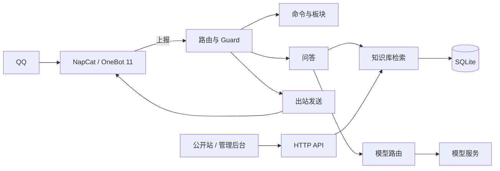

# Q-A-bot · QQ 群知识库问答机器人

<p align="center">
  <b>私有知识库检索、大模型作答与运营后台，运行在单个 Spring Boot 进程中</b>
</p>

<p align="center">
  
  
  
  
  
</p>

> 文档：[架构](docs/architecture.md) · [检索](docs/retrieval.md) · [知识库](docs/knowledge-base.md) · [部署](docs/deployment.md) · [开发](docs/development.md) · [English](README.en.md)

## 项目说明

Q-A-bot 是面向游戏社群的自托管 QQ 机器人，通过 OneBot 11 接入 QQ。收到提问后，系统先在私有知识库中检索，再将命中资料交给大模型组织回答；检索不到依据时明确说明，不使用模型记忆补全。

同一进程同时提供命令与定时板块、交互地图、语音回复、聊天蒸馏、公开站与管理后台。结构化数据存储于单个 SQLite 文件，图片、地图瓦片与语音素材使用本地目录，不依赖 Redis、消息队列或第二套数据库。

| 入口 | 使用者 | 主要用途 |
|---|---|---|
| QQ 群 | 群成员 | @ 提问、斜杠命令、定时板块、语音回复 |
| 公开站 | 群成员与访客 | 资料检索、条目浏览、交互地图 |
| 管理后台 | 运维者 | 知识库、命令与板块、地图、聊天蒸馏、统计与系统配置 |

## 核心能力

| 能力 | 实现 |
|---|---|
| 知识库问答 | 正文向量、术语关键词、标题向量三路召回；RRF 融合后由交叉编码器重排，取前 5 条作为回答依据。详见[检索设计](docs/retrieval.md) |
| 工具调用 | 模型可调用 `lookup`、`search_titles`、`locate` 三个只读工具，单次请求最多 3 次、3 轮、30 秒 |
| 命令与定时板块 | 话术、动作、智能问答三类命令；板块支持每天、每周、每 N 天与共 N 次投递，失败自动重试 |
| 地点问答与地图 | 返回相对最近地标的方位与距离，并生成带点位标注的地图截图 |
| 语音回复 | 支持 edge-tts 合成、音频素材库、关键词触发与模型工具 `play_voice` 触发 |
| 聊天蒸馏 | 采集指定群聊，分批交给模型蒸馏为知识笔记，经人工审核后导入知识库 |
| 安全与成本 | 五层本地判定零 token 拦截；用户、群、全局三级每日预算；出站过滤与发送节流 |
| 公开站与管理后台 | 公开只读检索与交互地图；后台提供知识库、命令、地图、页面文案与系统配置 |

## 架构



| 阶段 | 处理 |
|---|---|
| 接入与分诊 | 去重后立即返回 204；以 `/` 开头的消息进入命令池，其余进入问答池 |
| 准入与命令 | 群聊必须 @、私聊策略、群与用户黑名单；话术命令直接渲染，智能问答继续进入安全流程 |
| 安全与预算 | access → mention → rate-limit → content-gate → inbound-words，随后检查每日预算 |
| 检索与作答 | 三路召回与重排；资料以 `<<<KNOWLEDGE>>>` 注入，模型可调用只读工具 |
| 出站与记录 | 统一由 `OutboundSender` 过滤、分片、合并转发并控制节奏，同时写入问答统计 |

模块边界由 `ArchitectureTest` 的 14 条 ArchUnit 规则强制，覆盖协议、发送、模型、SQL、知识库分层与配置依赖，违反即构建失败。数据模型、目录结构与配置优先级见[架构设计](docs/architecture.md)。

## 技术栈

| 层 | 选型 |
|---|---|
| 后端 | Java 17、Spring Boot 3.5.16、LangChain4j 1.20.0 |
| 存储 | SQLite、sqlite-jdbc 3.53.4.0、WAL、单连接串行写入、约 40 张表 |
| 检索 | bge-m3 向量、术语表关键词、标题向量闸门、bge-reranker-v2-m3 重排 |
| 前端 | Vue 3.5、Vue Router 4、Vite 6、TypeScript 5.7、自研组件库 |
| 协议与部署 | NapCat、OneBot 11、Docker、Nginx、systemd |
| 其他 | Java2D 地图出图、Apache POI 5.3、JUnit 5、ArchUnit 1.3、Playwright |

## 快速开始

依赖 JDK 17+、Maven 3.9+、Node 20+、pnpm、Docker。网络需可访问模型 API 与 wiki.gg；语音回复另需 ffmpeg 与 edge-tts。

```bash
cp .env.example .env
# 填写 ONEBOT_TOKEN、OPENCODE_GO_API_KEY、SILICONFLOW_API_KEY、ADMIN_PASSWORD

(cd deploy && docker compose up -d)   # 启动 NapCat 并扫码登录
./scripts/build-web.sh                # 构建前端并同步到 server/web-dist
(cd server && mvn spring-boot:run)    # 启动业务层
```

服务监听 `0.0.0.0:8080`。公开站为 `/`，管理后台为 `/admin/`。启动后可执行健康自检：

```bash
./scripts/health-check.sh
```

脚本为 bash，Windows 请在 WSL 或 Git Bash 中执行。完整环境准备、systemd 与 Nginx 配置见[部署指南](docs/deployment.md)；本地开发、测试分层与回归门禁见[开发指南](docs/development.md)。

## 配置

| 变量 | 必填 | 说明 |
|---|---|---|
| `ONEBOT_TOKEN` | 是 | 与 NapCat 的 Access Token 一致 |
| `OPENCODE_GO_API_KEY` | 是 | 默认对话模型 |
| `SILICONFLOW_API_KEY` | 是 | 向量与重排模型 |
| `ADMIN_PASSWORD` | 是 | 为空时管理后台整体返回 503 |
| `DEEPSEEK_API_KEY` | 否 | 对话模型降级链 |

配置优先级从低到高为 `application.yml`、环境变量与 `.env`、`config/overrides.yml`、命令行参数。数据库、知识库、图片、瓦片与日志路径均相对进程工作目录；从 `server/` 启动时位于 `server/data/`。系统提示词为仓库根目录的 `system.md`，模板为 `system.md.example`。

完整变量与运行参数见 [.env.example](.env.example) 与[部署指南](docs/deployment.md)。

## 目录结构

```text
server/       Spring Boot 单体，业务层与 HTTP 接口
web/          前端双端：public 公开站、admin 管理后台、shared 组件与主题
deploy/       NapCat 容器与 Nginx 配置
scripts/      构建、自检、发版检查、检索门禁、文档校验
docs/         架构、检索、知识库、部署、开发文档
tests/        黄金集、可移植 UI 测试、手工探针、清理 SQL
```

## 质量保障

质量保障由三层组成：后端单元与集成测试、14 条 ArchUnit 架构约束、检索黄金集门禁；前端另有 Playwright 审计，检查横向溢出、命中区尺寸、控制台错误与主题一致性。发布前统一执行：

```bash
./scripts/preflight.sh      # 密钥、测试、打包、前端构建、数据库与检索门禁
./scripts/golden-gate.sh    # 仅执行检索回归
```

测试说明见[开发指南](docs/development.md)。

## 文档

- [架构设计](docs/architecture.md)：进程拓扑、消息流水线、模块边界、数据模型、配置体系
- [检索设计](docs/retrieval.md)：三路召回、RRF、重排、工具调用、公开站检索
- [知识库](docs/knowledge-base.md)：块模型、文档格式、导入语义、语料摄入与运维
- [部署指南](docs/deployment.md)：NapCat、systemd、Nginx、备份、升级与排障
- [开发指南](docs/development.md)：本地环境、构建、测试分层、提交检查
- [文档索引](docs/README.md)：阅读顺序

## 已知边界

| 项 | 说明 |
|---|---|
| 单实例 | 按 2 核 2 GB 单机与中小社群设计，SQLite 与内存缓存不支持多实例水平扩展 |
| QQ 协议 | 依赖 NapCat 与专用账号，存在风控与登录失效风险 |
| 语料与地图 | 默认适配《雾锁王国》；仓库不携带游戏语料，替换游戏需自行准备语料与地图源 |
| 模型 | 需要外部 OpenAI 兼容 API，向量与重排需要独立的 embedding 服务 |
| 管理后台 | 仅单管理员，无多用户与角色体系 |

## 许可

仓库暂未附带许可证文件。使用、转载或二次分发前请联系作者。
