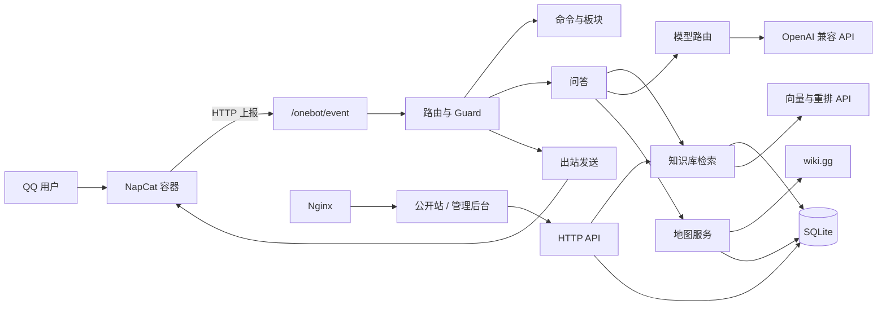
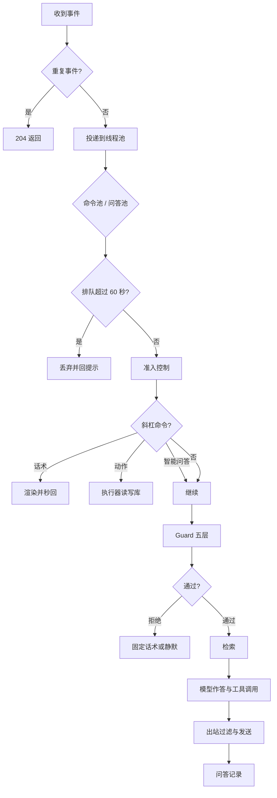

# 系统架构

## 1. 定位与边界

本项目是一个单体 Spring Boot 进程，为 QQ 群提供知识库问答，同时承载命令系统、定时投递、交互地图、公开站与管理后台。

设计上有三条硬边界：

| 边界 | 内容 |
|---|---|
| 协议 | QQ 协议由 NapCat 处理，业务层只认 OneBot 11 的 JSON。`onebot/` 是唯一知道协议细节的包 |
| 状态 | 结构化业务数据落在一个 SQLite 文件，图片与地图瓦片走本地目录。没有 Redis、消息队列或第二个数据库 |
| 进程 | 群消息、HTTP 接口、定时任务、地图出图共用同一个 JVM。部署单位是一个进程加数据目录 |

这三条边界决定了扩展方式：增加能力优先在现有模块内完成，不引入新的运行时组件。

## 2. 组件拓扑



对外暴露三类接口：

| 前缀 | 用途 | 鉴权 |
|---|---|---|
| `/onebot/event` | NapCat 事件上报 | OneBot Token |
| `/api/public/v1/**` | 公开站只读数据、检索、地图 | 无，应用层限流；旧 `/api/public/**` 兼容转发 |
| `/admin/api/**` | 管理后台 | 会话 Cookie；未配置密码时整体返回 503 |

## 3. 消息生命周期



各阶段对应的组件：

| 阶段 | 组件 | 关键行为 |
|---|---|---|
| 接入 | `OneBotEventController` | 去重后立即返回 204，处理放线程池 |
| 分诊 | `EventDispatcher` | 正文以 `/` 开头进命令池，其余进问答池 |
| 准入 | `Access` | 群聊必须 @、私聊策略、群与用户黑名单 |
| 命令 | `CommandHandler` | 话术、动作、智能问答三类分流 |
| 安全 | `GuardPipeline` | access → mention → rate-limit → content-gate → inbound-words |
| 预算 | `BudgetGuard` | 用户、群、全局每日额度与 token 上限 |
| 问答 | `ChatService` + `KbToolAssistant` | 组装消息、驱动官方检索管线、调用模型 |
| 出站 | `OutboundSender` | 过滤、分片、合并转发、发送节奏 |
| 记录 | `QaCollector` | 问题、回答、检索指标、耗时、关键词 |

命令在 Guard 之前执行，但准入在命令之前。这样 `/help` 不受问答限流影响，被拉黑的人也不能通过命令绕过准入。智能问答类命令会回到 Guard 与预算流程，因为它确实会调用模型。

## 4. 模块边界

`ArchitectureTest` 用 ArchUnit 强制 14 条依赖规则，违反即构建失败。

| 包 | 职责 | 约束 |
|---|---|---|
| `onebot` | OneBot 协议、消息编解码、HTTP 客户端 | 业务包不得依赖 `onebot.client` |
| `onebot.outbound` | 唯一发送出口 | 只有本包与 `router` 能接触 `OneBotApiClient` |
| `guard` | 零成本准入、限流、内容闸门、出站过滤 | 不得依赖 `kb`、`qa`、`llm` |
| `router` | 事件编排、排队、出站调度 | 不包含检索与模型实现 |
| `agent` | 组装对话消息、调用助手 | 不直接接触协议客户端 |
| `command` | 命令定义、解析、权限、板块与投递 | 通过 `OutboundSender` 发送 |
| `kb` | 语料、检索、聚合、知识库管理 | 不得依赖 `qa`、`publicapi`、`admin`、`settings` |
| `kb.wiki` / `kb.map` | 摄入生产者 | 核心不得反向依赖生产者，生产者不得持有索引 |
| `llm` | 模型路由、降级链、系统提示词、工具装配 | 唯一允许依赖模型 SDK 的包 |
| `qa` | 问答记录、统计、清理 | 不得依赖 `kb` |
| `persistence` | JDBC 与建表 | 唯一允许出现 `java.sql` 的包 |
| `settings` / `config` | 配置中心与装配 | 业务包不得依赖 `config` |
| `publicapi` / `admin` / `site` | HTTP 接口与站点内容 | 公开接口使用独立 DTO，不复用管理接口 |

14 条规则覆盖协议细节收敛、发送出口唯一、模型 SDK 收敛、SQL 收敛、知识库分层与配置依赖。新增包时需要同步更新 `ArchitectureTest` 里的包名单。

## 5. 数据模型

一个 SQLite 文件保存全部结构化状态，默认路径 `server/data/qa/qqbot.sqlite`。启用 WAL，单连接串行写入。

| 前缀 | 表数 | 内容 |
|---|---|---|
| `bot_` | 10 | 命令、板块、定时记录、权限、提示词、系统回复、元数据 |
| `kb_` | 14 | 块、正文向量、标题向量、分类、wiki 页面与来源、地图页面、点位、图层、备注 |
| `chat_` / `distill_` | 10 | 群聊采集、蒸馏任务、笔记、来源与导入记录 |
| `qa_` | 3 | 问答原文、派生指标、关键词 |
| `site_` | 2 | 页面文案、首页轮播 |
| `voice_` | 2 | 语音素材与触发规则 |
| `admin_visit` | 1 | 后台访问记录 |

几个关键约定：

| 约定 | 说明 |
|---|---|
| 块身份 | `kb_block.id` 是主键，不使用行号。删除与重排不影响引用 |
| 向量分离 | 正文向量存 `kb_block_vec`，标题向量存 `kb_block_title_vec`，避免列出块时读出大 BLOB |
| 语料版本 | 每次写入块表版本加一，检索缓存与下游快照据此失效 |
| 原文保留 | `qa_raw` 按保留天数清理，`qa_stat` 与 `qa_keyword` 长期保留 |
| 下架 | `retired = 1` 的块不参与检索，但数据保留，可恢复 |

## 6. 配置体系

配置有四个来源，优先级从低到高：

```text
application.yml
  → 环境变量与 .env
  → config/overrides.yml
  → 命令行参数
```

管理后台的「设置」页只允许修改白名单内的键。修改通过反射写入配置对象，下一次调用即生效，同时写入 `config/overrides.yml` 持久化。以下配置不支持热改：数据库路径、知识库目录、缓存容量、线程池大小、模型列表。

相对路径一律以进程工作目录为基准。从 `server/` 启动时，数据落在 `server/data/`。启动日志会打印解析后的绝对路径，部署后应先核对这些路径。

系统提示词放在仓库根目录的 `system.md`，加载顺序为外部文件、classpath 副本、兜底话术。修改后重启生效，不需要重新打包。

对外展示身份由 `app.bot.name` 统一驱动：公开站品牌、浏览器标题、页脚署名与管理后台品牌都读同一个值。`org` 与 `author` 为空时，关于页自动隐藏对应行。

## 7. 并发与成本

| 机制 | 默认值 | 目的 |
|---|---|---|
| 问答池 / 命令池 | 6 / 3 线程 | 命令风暴不挤占问答 |
| 队列容量 | 500 | 过载时快速失败 |
| 排队上限 | 60 秒 | 超过后回一句「稍后再试」 |
| 群限流 | 10 条/分钟 | 防止整群刷屏 |
| 用户限流 | 1 次/20 秒 | 防止单人连问 |
| 每日预算 | 默认 0 即不限 | 可按用户、群、全局、token 设置上限 |
| 工具调用 | 3 次、3 轮、30 秒 | 控制检索深度与响应时间 |
| 出站节奏 | 群与账号各 500 毫秒 | 降低风控概率 |
| 单条长度 | 300 字 | 超出按句子分片，段数多时合并转发 |

模型调用按「默认 provider → 降级链」顺序尝试。超时、额度、空回复都会触发下一个 provider。需要视觉能力时只在声明了 `vision` 的 provider 中选择，需要工具时只在声明了 `tools` 的 provider 中选择。

## 8. 地图出图

地图数据来自 wiki 的 Map 命名空间，同步为页面、分组、点位三层。查看器与地点问答共用这些数据。

另有一层资源点位，来自 The Worst Map Mod 导出的世界数据快照：36,126 个点、2,120 块林地、112 个图层，存于 `kb_map_resource_meta` / `kb_map_resource_layer` / `kb_map_resource` / `kb_map_resource_area`，与 wiki 同步完全分开。首次请求资源目录时按 `points.json` 导入，文件哈希不变就跳过；点位带 `source_version` 与 `canvas_fp`，游戏更新不自动重导，画布变化时靠指纹发现。接口是 `/api/public/v1/map/resource-groups`、`/api/public/v1/map/resources`、`/api/public/v1/map/resource-areas` 与 `/api/public/v1/map/resource-icon`，前端按层懒加载。图层带物品图标：图标是透明底 PNG，放在 `classpath:map-icons`，由 `map-mod/icons.json` 按层映射；没有图的层退回颜色圆点。

出图流程：

1. 问题命中地点意图后，按点位坐标确定视口。
2. 只读取与视口相交的瓦片，逐张解码、绘制，不加载整张 10240×10240 底图。
3. 以目标点为中心绘制标记与最近地标名称，编码为 JPEG。
4. 取瓦片有时间预算，超时或缺瓦片则放弃出图，只返回文字。
5. 出站回复中的 `[[img:map:...]]` 标记由出站层替换为图片。

地图同步、地点语料派生与瓦片预热是三个独立任务。同步失败不影响检索，只是底图首次加载变慢。

## 9. 可观测性

| 通道 | 用途 |
|---|---|
| 控制台与滚动文件 | 完整运行日志，默认保留 7 天、总量 200 MB |
| 内存环形缓冲 | 管理后台实时日志页，通过 SSE 推送 |
| `qa_stat` | 每次问答的检索与模型指标，用于看板与黄金集分析 |
| `KbTrace` | 召回数、最高余弦、命中块、术语命中、耗时 |
| Guard 指标 | 各阶段拦截计数，按窗口统计 |

日志默认脱敏 Token、密钥、QQ 号与带签名的 URL。管理后台日志页可能被截图外发，除非排障需要，否则不应关闭脱敏。

## 10. 目录结构

```text
server/       Spring Boot 单体，唯一进入生产的 Java 代码
web/          前端双端构建：public 公开站、admin 管理后台、shared 组件与主题
deploy/       NapCat 容器与 Nginx 配置
scripts/      构建、自检、回归门禁、文档校验
docs/         项目文档
tests/        黄金集、可移植 UI 测试、手工探针与清理 SQL
```
