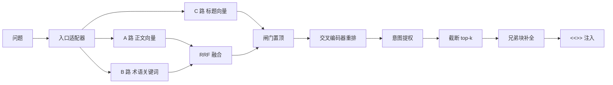

# 检索与作答

## 1. 设计约束

语料主体来自英文 wiki，提问以中文口语为主。这带来两个具体问题：

| 问题 | 表现 |
|---|---|
| 名字与正文分离 | 标题是「中文名（English）」，正文是简介，几乎不重复标题里的名字。用名字提问时，正文向量会把同族变体排在前面 |
| 绝对分数不可判别 | 双塔余弦中「该答」与「库里没有」的分布重叠，调相似度阈值必然两头受损 |

因此检索不是单路向量，而是三路召回、排名融合、交叉编码器重排。最终是否给出资料由重排分决定，向量余弦只做粗筛。

## 2. 管线



| 步骤 | 实现 | 说明 |
|---|---|---|
| 入口适配 | `KbContextQueryTransformer` | 外部入口自己构造 Query 时补齐语料上下文，否则两路会静默返回空 |
| 召回 | `VectorContentRetriever`、`KeywordContentRetriever` | 两路都跑，任一路失败不影响另一路 |
| 融合 | `RrfFuser` | 按排名融合，不比较原始分数 |
| 置顶 | `TitleVectorGate` | 标题语义命中时把对应块直接置顶 |
| 重排 | `CrossEncoderReranker` | 问题与文档拼接打分，是唯一能用绝对分判断「有没有资料」的一层 |
| 意图提权 | `KbRetriever.applyPlaceIntent` | 地点类问题提升地点块 |
| 补全 | `KbSiblingExpander` | 同一文档的兄弟块追加在末尾 |
| 注入 | `KbContentInjector` + `TwoSectionInjector` | 渲染为 `<<<KNOWLEDGE>>>` 段，按出处分两段 |

## 3. 三路召回

| 路 | 输入 | 选型 | 作用 | 失效时 |
|---|---|---|---|---|
| A 正文向量 | 块正文 | `BAAI/bge-m3`，1024 维，余弦 | 语义相近的中文提问 | 降级为纯关键词 |
| B 术语关键词 | 问题中命中的中文术语 | 术语表精确匹配 | 把标准名词一击命中，精度高 | 仍可依赖向量 |
| C 标题向量 | 块标题 | 同一 embedding 模型 | 解决「用户打的就是这个名字」 | 关闭，不影响 A/B |

正文向量与关键词路的候选数取 `max(topK × 4, 20)`，为融合与重排留出余量。标题闸门直接扫描标题向量，不占用候选池。

## 4. 融合与重排

### 4.1 RRF

```text
score(d) = Σ weight_i / (K + rank_i(d))
K = 10
关键词路 weight = 2.0
```

关键词路权重更高，因为它命中的是术语表里的标准名词，精度高于语义近邻。

标题还有两级加成：

| 条件 | 加成 |
|---|---|
| 标题正好等于问题中的术语 | +0.5 |
| 标题包含该术语 | +0.15 |

加成解决的是同族变体压过本体的问题。例如搜「废料杯」时，正文提到 Scrap Cup 的餐具页面不应压过条目本身；搜「火把」时，同族装饰火把不应排在前面。

### 4.2 标题闸门

C 路计算问题向量与标题向量的最高余弦，超过 `title-gate=0.70` 即认定用户在问某个具体名字，将命中的块置顶。置顶不参与 RRF 投票，但保留在结果中。

阈值来自实测：0.70 时名字查询全部触发，真实口语提问误触发约 2.5%；降到 0.65 误触发升到约 10%；升到 0.80 名字覆盖率下降。调整前应先看日志中的余弦分布。

### 4.3 重排

| 参数 | 默认值 | 含义 |
|---|---|---|
| `candidate-limit` | 20 | 送进重排的候选数，必须大于 `top-k` |
| `min-score` | 0.02 | 重排最高分低于它即认为库里没有资料 |
| 模型 | `BAAI/bge-reranker-v2-m3` | 不参与建索引，换模型不需要重建向量 |

重排失败时保持原顺序继续回答，不因增强层故障而拒绝服务。标题闸门命中时不允许重排把结果清空。

### 4.4 兄弟块

长页面按段落切成多块。命中一块后，同文档的其余块追加在结果末尾，默认最多 6 块、5000 字。追加不改变前 `top-k` 的排名，因此基线指标不受影响。公开站搜索关闭该行为，因为那里按页面去重后展示条目列表。

## 5. 资料注入与工具

命中块渲染为 `<<<KNOWLEDGE>>>` 段交给模型。渲染分两段：

| 段落 | 来源 | 提示语 |
|---|---|---|
| 我们维护的内容 | `source=manual` | 我们自己写过或改过 |
| 导入的资料 | `source=doc`、`wiki` | 从外部整理导入，可能已过期 |

两段都标注标题与 URL，不声明哪一段更权威。模型需要自己判断时效与出处。

模型可调用三个只读工具：

| 工具 | 用途 | 约束 |
|---|---|---|
| `lookup` | 按问题或关键词检索知识库 | 返回相关度与标题命中标记 |
| `search_titles` | 按英文关键词查条目名 | 用于中文名转英文名 |
| `locate` | 查询地点或资源的位置 | 返回相对最近地标的方位、距离与坐标 |

工具调用有三道预算：单次请求最多 3 次调用、3 轮往返、30 秒总时限。超预算时返回提示文本，让模型用已有资料收尾，而不是抛错。工具全部只读，改数据与发消息不开放给模型。

结果中会附带标题命中数量。标题一条都没命中时，工具会提示模型换英文关键词重试，最多两次。这个信号是结构性的，不依赖绝对相似度。

## 6. 群内与公开站

同一套检索器，两组参数：

| 参数 | 群内问答 | 公开站搜索 |
|---|---|---|
| `top-k` | 5 | 20 |
| `min-score` | 0.45 | 0.32 |
| 重排 | 开启 | 关闭 |
| 兄弟块 | 开启 | 关闭 |
| 向量配额 | 无 | 每天 800 次，超出降级为关键词 |
| 结果缓存 | 512 条，随语料版本失效 | 512 条 LRU |
| 去重 | 不按页面去重 | 按文档去重后展示 |

群内检索要「宁缺毋滥」，公开站要「按相关度给人看」，因此阈值与返回量不同。公开站还要额外承受公网流量，所以有每日向量配额与结果缓存。

## 7. 缓存与失效

缓存键包含语料版本、问题、是否允许向量、`top-k`、`min-score`、是否重排、是否补全兄弟块。任一参数不同即为不同请求，不互相命中。

块表每次写入都会提升语料版本，旧缓存自然失效，不需要手工清理。缓存容量在启动时确定，修改后需要重启。

## 8. 失败与降级

| 故障 | 行为 |
|---|---|
| 向量 API 不可用 | 记录日志，只用关键词路；检索结果可能变少 |
| 重排 API 不可用 | 保持融合顺序，照常回答 |
| 语料为空或未初始化 | 跳过检索，直接让模型回答，并在日志中标注 |
| 同文档兄弟块缺失 | 只返回命中的块 |
| 公开站配额用尽 | 当天剩余请求走纯关键词，不报错 |
| 地点出图超时 | 只返回文字与坐标 |

降级的原则是「回答可以变弱，但不能因为增强层故障而拒绝服务」。

## 9. 质量基线

`tests/golden/retrieval-golden.tsv` 是检索回归集，按五类分别统计：实体名、口语提问、库外问题、闲聊、描述型问题。分类统计的原因是平均值会掩盖结构性缺陷。

```bash
./scripts/golden-gate.sh              # 生产路径，重排开启
./scripts/golden-gate.sh --rerank off # 对比重排贡献
```

门禁语义是「不许比基线更差」。缺少语料、缺少 API Key 或向量路不通都算失败，不会静默跳过。改动检索逻辑、语料或阈值后必须跑门禁，并在提交说明中写清哪条样本因此变化。

## 10. 可调参数

| 参数 | 默认 | 调整影响 |
|---|---|---|
| `app.kb.top-k` | 5 | 变大给模型更多资料，也更容易稀释重点并撑大 prompt |
| `app.kb.min-score` | 0.45 | 只做粗筛。调高会挡掉口语提问，调低会放入噪音 |
| `app.kb.title-gate` | 0.70 | 调低增加误置顶，调高漏掉名字查询 |
| `app.kb.rerank.min-score` | 0.02 | 决定「没有资料」的判定，是全链路最敏感的一项 |
| `app.kb.rerank.candidate-limit` | 20 | 必须大于 `top-k`，否则重排没有翻盘空间 |
| `app.kb.sibling.max-blocks` | 6 | 补全过多会撑大 prompt |

修改上述参数后必须重跑黄金集。没有基线背书的参数调整不应合入。
